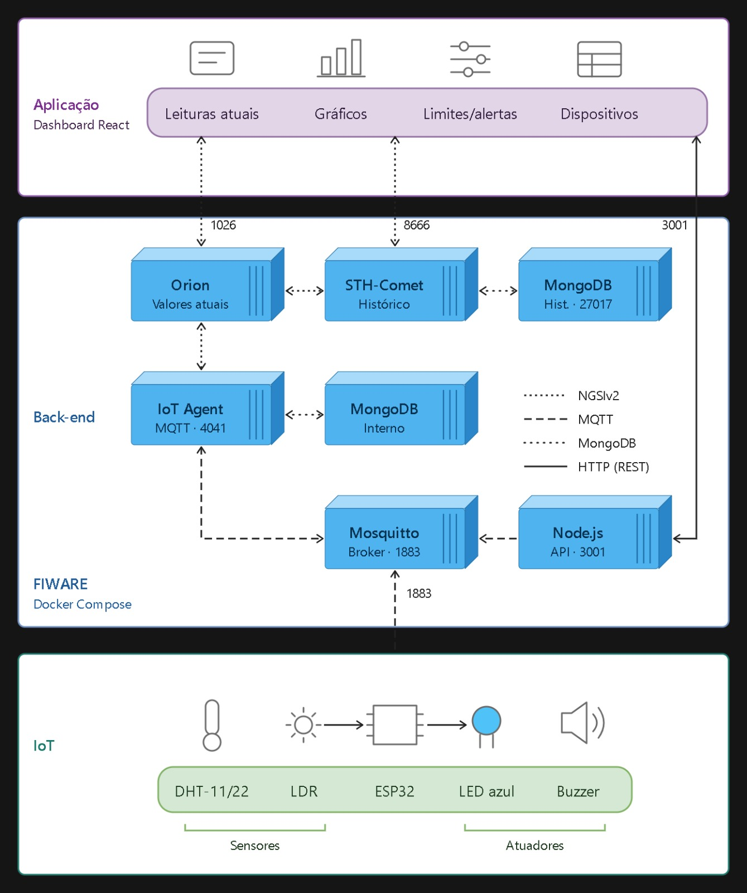

# Vinheria — Sistema Inteligente de Monitoramento Ambiental

Sistema IoT para monitoramento das condições ambientais de uma vinheria, desenvolvido com ESP32, sensores, MQTT, FIWARE e um dashboard web em React. A solução permite acompanhar temperatura, umidade e luminosidade, consultar dados históricos, configurar limites de operação e emitir alertas visuais e sonoros quando forem identificadas condições fora dos parâmetros definidos.

## Índice

1. [Descrição completa da solução](#1-descrição-completa-da-solução)
2. [Arquitetura em camadas](#2-arquitetura-em-camadas)
3. [Manual de instalação e operação](#3-manual-de-instalação-e-operação)

---

# 1. Descrição completa da solução

## 1.1. Contexto e objetivo

A conservação adequada dos vinhos depende de condições ambientais controladas. Variações de temperatura, umidade e luminosidade podem comprometer as condições de armazenamento e exigir uma intervenção rápida.

O projeto propõe uma solução de monitoramento ambiental baseada em Internet das Coisas (IoT), permitindo acompanhar essas variáveis por meio de sensores conectados a um ESP32. As informações são transmitidas por MQTT, integradas à plataforma FIWARE e disponibilizadas em um dashboard web.

O objetivo é facilitar a identificação de condições inadequadas, possibilitar o acompanhamento histórico das medições e oferecer alertas para situações que necessitem de atenção.

## 1.2. Funcionalidades principais

- **Monitoramento ambiental:** coleta de temperatura, umidade e luminosidade por meio de sensores conectados ao ESP32.
- **Dashboard web:** visualização das informações ambientais em uma interface desenvolvida com React.
- **Histórico de medições:** consulta de dados históricos e apresentação por meio de gráficos utilizando o STH-Comet.
- **Configuração de limites:** definição de valores para identificar condições ambientais fora dos parâmetros estabelecidos.
- **Alertas visuais:** utilização de um LED azul piscante para sinalizar anomalias.
- **Alertas sonoros:** utilização de um buzzer com padrões sonoros distintos para diferenciar ocorrências de temperatura, umidade e luminosidade.
- **Comunicação IoT:** transmissão das medições e recebimento de comandos por MQTT.
- **Gerenciamento de dispositivos:** interface destinada ao cadastro e ao gerenciamento dos dispositivos IoT, conforme a implementação do dashboard.

## 1.3. Diferenciais da solução

### Índice de risco para conservação dos vinhos

Indicador destinado a representar o nível de risco das condições ambientais, considerando temperatura, umidade e luminosidade. A classificação deve seguir as regras definidas no sistema, permitindo interpretar as medições de forma mais direta.

### Relatório de exposição ambiental

Recurso destinado a analisar o histórico e identificar períodos em que o ambiente permaneceu fora dos limites configurados. Seu objetivo é facilitar a avaliação da exposição a condições potencialmente inadequadas.

### Relatório de condições ambientais

Recurso destinado a apresentar estatísticas das medições históricas, incluindo valores mínimos, máximos e médios de temperatura, umidade e luminosidade em um período selecionado.

> **Observação:** os três diferenciais devem ser conferidos no código final para garantir que estejam implementados e funcionando antes da entrega.

## 1.4. Tecnologias utilizadas

| Tecnologia                  | Aplicação                                               |
| --------------------------- | ------------------------------------------------------- |
| ESP32                       | Leitura dos sensores e controle dos alertas físicos     |
| DHT22                       | Medição de temperatura e umidade                        |
| LDR                         | Medição da luminosidade                                 |
| LED azul                    | Sinalização visual de anomalias                         |
| Buzzer                      | Sinalização sonora                                      |
| Wokwi                       | Simulação do circuito eletrônico                        |
| C++ / Arduino               | Programação do ESP32                                    |
| MQTT / Mosquitto            | Comunicação entre o dispositivo e os serviços           |
| FIWARE Orion Context Broker | Gerenciamento de informações de contexto                |
| FIWARE IoT Agent MQTT       | Integração dos dispositivos com a plataforma FIWARE     |
| STH-Comet                   | Consulta e armazenamento de histórico de medições       |
| MongoDB                     | Armazenamento utilizado pelos componentes da plataforma |
| Node.js / Express           | Backend e integração entre o dashboard e os serviços    |
| React / JavaScript / CSS    | Desenvolvimento da interface web                        |

## 1.5. Funcionamento da solução

1. O ESP32 realiza a leitura dos sensores de temperatura, umidade e luminosidade.
2. As medições são transmitidas por MQTT.
3. A plataforma FIWARE recebe e gerencia os dados do dispositivo.
4. O STH-Comet disponibiliza o histórico para consulta.
5. O backend em Node.js e Express intermedeia as solicitações do dashboard e as consultas aos serviços.
6. O dashboard React apresenta as medições, os gráficos e os controles disponíveis.
7. Quando uma condição ultrapassa os limites configurados, o sistema solicita a ativação do alerta correspondente.
8. O backend publica o comando MQTT, que deve ser interpretado pelo ESP32.
9. O ESP32 aciona o LED azul e o buzzer conforme o tipo de anomalia.
10. Quando a condição volta à normalidade, o sistema deve desativar os alertas.

## 1.6. Comunicação MQTT

Os tópicos utilizados pelo dispositivo incluem:

| Tópico                 | Finalidade                       |
| ---------------------- | -------------------------------- |
| `/TEF/lamp001/attrs/t` | Publicação da temperatura        |
| `/TEF/lamp001/attrs/h` | Publicação da umidade            |
| `/TEF/lamp001/attrs/l` | Publicação da luminosidade       |
| `/TEF/lamp001/attrs`   | Publicação de atributos e estado |
| `/TEF/lamp001/cmd`     | Recebimento de comandos          |
| `/TEF/lamp001/alert`   | Comunicação de alertas           |

O backend envia comandos para o tópico `/TEF/lamp001/cmd`, utilizando mensagens que identificam o dispositivo e o estado solicitado. O código do ESP32 deve interpretar os comandos de temperatura, umidade, luminosidade e normalidade para executar o comportamento esperado.

---

# 2. Arquitetura em camadas

A arquitetura organiza a solução em camadas responsáveis pela coleta de dados, comunicação, processamento, armazenamento e apresentação das informações.

## 2.1. Diagrama da arquitetura




*Figura 1 — Arquitetura em camadas da solução de monitoramento ambiental da vinheria.*

> Salve a imagem da arquitetura na pasta `docs` com o nome `arquitetura-camadas.png`. Se utilizar outro nome ou formato, atualize o caminho acima.

## 2.2. Camadas da solução

### Camada física — Sensoriamento e atuação

Composta pelo ESP32, sensor DHT22, sensor LDR, LED azul e buzzer. É responsável por coletar as variáveis ambientais e executar os alertas físicos.

### Camada de comunicação — MQTT

Responsável pela troca de mensagens entre o dispositivo e os serviços da plataforma. O broker Mosquitto recebe e distribui as mensagens publicadas nos tópicos MQTT.

### Camada de integração IoT — FIWARE

O IoT Agent MQTT integra as mensagens dos dispositivos ao ambiente FIWARE, enquanto o Orion Context Broker gerencia os dados de contexto.

### Camada de armazenamento e histórico

O MongoDB fornece armazenamento para os componentes que o utilizam. O STH-Comet disponibiliza os dados históricos necessários para a construção dos gráficos e relatórios.

### Camada de serviços — Backend

Desenvolvida com Node.js e Express. Recebe solicitações do frontend, encaminha consultas ao histórico e publica comandos MQTT para o dispositivo.

### Camada de apresentação — Frontend

Desenvolvida com React, JavaScript e CSS. Disponibiliza a interface de monitoramento, os gráficos, a configuração de limites e os recursos de gerenciamento dos dispositivos.

### Camada de análise — Diferenciais

Reúne os recursos de análise ambiental planejados para o projeto: índice de risco, relatório de exposição ambiental e relatório estatístico das condições ambientais.

---

# 3. Manual de instalação e operação

Este manual apresenta os procedimentos para preparar o ambiente, executar os componentes e utilizar a solução. Os comandos devem ser ajustados conforme os nomes reais das pastas e dos arquivos do repositório.

## 3.1. Requisitos de software

- Git instalado.
- Node.js e npm instalados.
- Editor de código, como Visual Studio Code.
- Navegador atualizado.
- Conta no Wokwi para simulação do ESP32.
- Ambiente FIWARE configurado e acessível.
- Broker MQTT acessível pela rede.
- Bibliotecas e dependências necessárias ao firmware e ao backend.

## 3.2. Requisitos de hardware

Para a montagem física ou simulação do circuito, são necessários:

- 1 ESP32.
- 1 sensor DHT22.
- 1 sensor LDR.
- 1 LED azul.
- 1 resistor adequado para o LED.
- 1 buzzer.
- Protoboard e jumpers, caso seja utilizada montagem física.
- Computador com acesso à rede.

## 3.3. Instalação e configuração do hardware

### Passo 1 — Preparar o circuito

Monte o circuito no Wokwi ou em uma protoboard, seguindo as conexões abaixo.

| Componente                     | Conexão no ESP32                       |
| ------------------------------ | -------------------------------------- |
| DHT22 — DATA                   | GPIO 15                                |
| LDR — saída analógica          | GPIO 34                                |
| LED azul — anodo, com resistor | GPIO 25                                |
| Buzzer — terminal positivo     | GPIO 26                                |
| LED integrado                  | GPIO 2                                 |
| GND dos componentes            | GND do ESP32                           |
| Alimentação dos sensores       | Conforme a especificação do componente |

**Atenção:** a montagem do LDR deve incluir o circuito necessário para produzir uma leitura analógica, normalmente com um divisor de tensão. Confira também os terminais de alimentação e a pinagem específica de cada componente.

### Passo 2 — Configurar o simulador

1. Abra o projeto do circuito no Wokwi.
2. Confira as conexões no arquivo `diagram.json`.
3. Verifique se o firmware utiliza os mesmos pinos definidos no circuito.
4. Confira se o sensor configurado no código corresponde ao modelo utilizado no projeto.
5. Inicie a simulação e acompanhe a saída serial.

### Passo 3 — Configurar o firmware

Abra o arquivo `.ino` do ESP32 e confira:

- Credenciais da rede Wi-Fi ou configuração da rede de simulação.
- Endereço IP e porta do broker MQTT.
- Identificador MQTT do dispositivo.
- Tópicos de publicação e assinatura.
- Pinos dos sensores e dos atuadores.
- Bibliotecas necessárias, como `WiFi`, `PubSubClient` e `DHT`.

Na simulação, a rede `Wokwi-GUEST` pode ser utilizada conforme a configuração do projeto. O endereço do broker deve ser acessível pelo ESP32 simulado.

Compile e execute o firmware. Verifique no monitor serial se o dispositivo conecta ao Wi-Fi, conecta ao broker MQTT e começa a realizar as leituras.

## 3.4. Instalação do ambiente FIWARE

Os serviços FIWARE devem estar configurados e acessíveis antes da validação completa da integração.

Confira a disponibilidade dos componentes:

| Serviço              | Porta usual no projeto |
| -------------------- | ---------------------: |
| Orion Context Broker |                   1026 |
| IoT Agent MQTT       |                   4041 |
| STH-Comet            |                   8666 |
| Mosquitto MQTT       |                   1883 |
| MongoDB              |                  27017 |

As portas correspondem à configuração utilizada no ambiente do projeto e podem variar conforme o `docker-compose.yml`.

### Procedimento

1. Entre na pasta que contém a configuração Docker do FIWARE.
2. Confira as variáveis de ambiente, as portas e os endereços dos serviços.
3. Inicie os contêineres conforme as instruções do repositório.
4. Verifique se os serviços estão ativos.
5. Confira se o IoT Agent está configurado para integrar o dispositivo.
6. Verifique se o Orion recebe os dados de contexto.
7. Confira se o STH-Comet está recebendo as notificações e disponibilizando o histórico.

Se o histórico não aparecer, verifique a assinatura de notificação do Orion para o STH-Comet, os endereços internos entre contêineres e os logs dos serviços.

## 3.5. Instalação e execução do backend

### Passo 1 — Abrir a pasta do backend

No terminal, navegue até a pasta que contém o arquivo `package.json` do backend.

### Passo 2 — Instalar as dependências

```bash
npm install
```

### Passo 3 — Configurar as variáveis de ambiente

Configure os endereços dos serviços, o broker MQTT e as demais informações necessárias. Utilize um arquivo `.env` caso o projeto esteja preparado para isso.

Exemplo ilustrativo:

```env
PORT=3001
MQTT_HOST=34.201.100.78
MQTT_PORT=1883
```

Os nomes das variáveis devem corresponder aos utilizados no código. Não publique credenciais, senhas, tokens ou informações privadas no GitHub.

### Passo 4 — Iniciar o backend

Utilize o script configurado no `package.json`. Por exemplo:

```bash
npm start
```

Se o projeto utilizar outro script, como `npm run dev`, execute o comando correspondente.

Confirme no terminal se o servidor foi iniciado e se a conexão MQTT foi estabelecida.

## 3.6. Instalação e execução do frontend

### Passo 1 — Abrir a pasta do frontend

No terminal, entre na pasta do dashboard React, onde está localizado o `package.json`.

### Passo 2 — Instalar as dependências

```bash
npm install
```

### Passo 3 — Configurar o endereço do backend

Confira se a aplicação utiliza o endereço correto do backend. Se houver variáveis de ambiente, configure a URL correspondente à API.

Exemplo ilustrativo:

```env
VITE_API_URL=http://localhost:3001
```

O nome da variável depende da configuração utilizada pelo frontend.

### Passo 4 — Iniciar a aplicação

Em projetos React configurados com Vite, utilize:

```bash
npm run dev
```

Abra no navegador o endereço informado pelo terminal.

Se o frontend estiver em outra máquina, `localhost` deverá ser substituído pelo endereço de rede apropriado. Também devem ser verificadas as configurações de CORS e a acessibilidade do backend.

## 3.7. Operação do sistema

### Iniciar o monitoramento

1. Inicie o ambiente FIWARE e o broker MQTT.
2. Inicie a simulação ou ligue o circuito ESP32.
3. Inicie o backend.
4. Inicie o frontend.
5. Abra o dashboard no navegador.
6. Confira se as medições estão sendo recebidas e apresentadas corretamente.

### Configurar os limites ambientais

1. Acesse a área de configuração de limites do dashboard.
2. Defina os valores de referência para temperatura, umidade e luminosidade.
3. Salve ou aplique as configurações, conforme a interface implementada.
4. Observe as medições e verifique se as condições fora dos limites são identificadas.

Os limites devem seguir os critérios definidos pela equipe e não devem ser tratados como recomendações universais de conservação de vinhos.

### Testar os alertas

1. Altere a condição do sensor ou os valores simulados para provocar uma anomalia.
2. Confira se o dashboard identifica o tipo de alerta.
3. Verifique se o backend publica o comando MQTT.
4. Confirme se o ESP32 recebe o comando.
5. Verifique se o LED azul começa a piscar.
6. Confira se o buzzer emite o padrão sonoro correspondente.
7. Retorne os valores para a faixa normal e confirme a desativação do alerta.

### Consultar o histórico

1. Acesse a área de gráficos do dashboard.
2. Selecione o período disponível, caso exista esse filtro.
3. Confira se os dados históricos são carregados do STH-Comet.
4. Compare os registros apresentados com as medições publicadas pelo dispositivo.

### Utilizar os diferenciais

Se estiverem implementados na versão final:

- Consulte o índice de risco para interpretar as condições ambientais.
- Utilize o relatório de exposição para verificar ocorrências fora dos limites.
- Consulte o relatório estatístico para analisar valores mínimos, máximos e médios.

## 3.8. Solução de problemas

| Problema                      | Verificações recomendadas                                                                            |
| ----------------------------- | ---------------------------------------------------------------------------------------------------- |
| ESP32 não conecta ao Wi-Fi    | Conferir a configuração da rede, o SSID e a senha                                                    |
| ESP32 não conecta ao MQTT     | Verificar IP, porta, acessibilidade do broker e logs                                                 |
| Dashboard não apresenta dados | Conferir backend, endpoints, rede e console do navegador                                             |
| Gráficos históricos vazios    | Verificar registros no STH-Comet e notificações do Orion                                             |
| LED não pisca                 | Conferir GPIO 25, ligação elétrica, comando recebido e estado do alerta                              |
| Buzzer não emite som          | Conferir GPIO 26, polaridade, ligação e execução do código de alerta                                 |
| Alerta não chega ao ESP32     | Comparar o tópico e o formato da mensagem publicados pelo backend com os interpretados pelo firmware |
| Dados não aparecem no FIWARE  | Verificar tópicos MQTT, IoT Agent, entidade no Orion e logs dos serviços                             |
| Frontend não acessa o backend | Conferir URL da API, porta, CORS e disponibilidade do servidor                                       |

## 3.9. Segurança e boas práticas

- Não publique senhas, tokens ou credenciais no repositório.
- Utilize variáveis de ambiente para configurações privadas.
- Não exponha serviços FIWARE ou bancos de dados à internet sem controles de acesso adequados.
- Restrinja o acesso ao broker MQTT e utilize autenticação quando disponível.
- Evite utilizar dados de acesso de produção em ambientes de teste.
- Documente as alterações realizadas nas configurações e nos tópicos MQTT.

##

A estrutura acima é uma sugestão de organização. Os diretórios e os nomes dos arquivos devem corresponder aos existentes no repositório final.

---

## Integrantes

- Vinícius Campestrini
- Vinícius Honda
- Guilherme Villela
